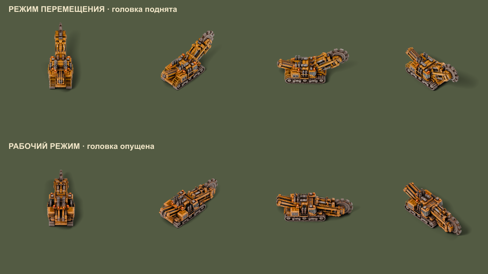
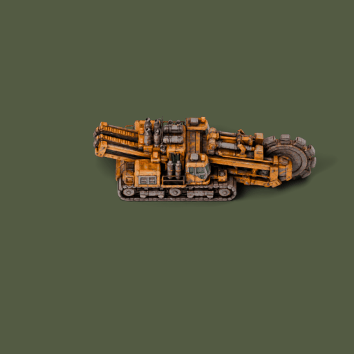

# Tracked Canal Digger

A heavy Factorio vehicle that excavates real water channels. Travel mode raises the cutting head; Work mode lowers it and converts ground near the wheel into water tiles.

**100% vibe-coded with Codex (OpenAI): all mod code was created with AI under the author’s direction. The 3D models were generated with Tripo AI.**

[Русский README](README.md) · [Credits](CREDITS.md) · [Download ZIP](https://github.com/TeamHeightline/heavy-canal-digger/releases)

Version **0.5.3**, Factorio **2.0**, `base >= 2.0.0`. Standalone; Space Age and Cargo Ships are optional. Excavation is available on Nauvis.

## Unlock and recipe

Unlocks with **Railway (`railway`)**, alongside the locomotive. Crafting takes **30 seconds** and produces one vehicle.

| Ingredient | Amount |
|---|---:|
| Steel plate | 100 |
| Iron gear wheel | 80 |
| Engine unit | 20 |
| Electronic circuit | 40 |
| Iron plate | 100 |

Cargo: **80 slots**. Fuel: **3 slots**, chemical fuel such as coal.

## Controls and excavation

W accelerates, S brakes/reverses, A/D steer. Choose **Travel** or **Work** in the vehicle window. Travel is the default, with a **30 km/h** speed limit; Work is limited to **3 km/h** and turns **five times more slowly**. R rotates placement previews and parked machines. Mode changes preserve cargo, fuel, occupants and health.

- The channel is nominally **5.75 tiles wide**; the actual outline follows the tile grid and vehicle heading. This is intended as a straight Cargo Ships corridor; sharp ship turns need wider basins.
- Each newly converted water tile produces **one Soil**. Existing water produces none. **20 Soil → 1 landfill**.
- The engine consumes **600 kW**; actual digging draws an additional **1.8 MW**. Empty fuel or full cargo pauses work. Concrete takes longer than natural ground.
- Buildings, trees, plants, rocks and cliffs block excavation and are not removed by the tool.
- This is a **land-only** vehicle, including around its own channel. Reverse over dry ground for continuous digging. Moving forward excavates ahead and then stops at the new bank. Ground beneath the chassis is protected; unsafe bank-side turns are rejected while dry-land escape remains available.
- Version 0.5.3 removes ground decoratives from excavated water. On upgrade it also clears water-anchored decoratives in a **±32-tile area** around existing machines. Dry-land decoratives and real tree/rock entities remain.

## Graphics

Two separate supplied USDZ poses, rendered in Blender: **64 fixed-scale directions**, orthographic 45-degree camera, soft lighting and shadows. The work wheel has **four animation phases driven by vehicle movement**; it stops when the vehicle stops. Placement previews and ghosts use actual vehicle sprites.

## Installation and updates

Download `heavy-canal-digger_0.5.3.zip` from [Releases](https://github.com/TeamHeightline/heavy-canal-digger/releases). Close Factorio, put the ZIP **without extracting it** in your profile’s `mods` folder, then enable it in-game. On Windows the folder is `%APPDATA%\Factorio\mods`.

For manual packaging, repository files belong inside a `heavy-canal-digger_0.5.3` folder within the ZIP. Existing saves and machine mode data are supported during upgrades. Original USDZ/Blender files are not bundled; all required sprites are included.

## Testing and credits

The author tested intermediate versions in-game. Final 0.5.3 changes received static checks and tests using a mocked game API. Factorio was not launched for the final patch at the author’s request; these checks do not establish in-game correctness.

For [bug reports](https://github.com/TeamHeightline/heavy-canal-digger/issues), include game/mod versions, other mods, mode and driving direction, reproduction steps, a screenshot and the relevant log excerpt.

Concept, requirements, supplied models, balance and gameplay feedback: **artel**. All code: **100% vibe coding with Codex (OpenAI)**. 3D generation: **Tripo AI**. Rendering: **Blender**. Unofficial Factorio mod; not a Wube Software product.
